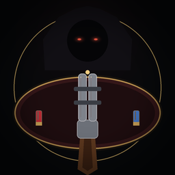

# 恶魔轮盘赌 · 内聚记忆（AstrBot 插件）

<p align="center"></p>

> 本项目不包含《恶魔轮盘赌》游戏本体、PCK 或任何游戏资源；Godot 补丁需要你自行拥有游戏并提取。项目与游戏开发商无关。

在 QQ 里和 AI 玩《恶魔轮盘赌》：

- 命令或自然语言开局，插件启动本地 Web 控制器；
- 玩家在手机/电脑网页看实时画面、开枪、用道具；
- 恶魔由 AstrBot 当前人格 LLM 接管，一次调用同时生成游戏操作和 QQ 台词；提示词会明确“你就是牌桌对面的庄家本人”，网页显示人格名而不是固定的“恶魔”；
- 内置 SQLite FTS5 记忆核：本局算牌便条、跨局玩家画像、恶魔博弈法则；
- 可以用自然语言让 AI 自己练几局变强，也可以让它这局别用记忆、正常打；
- 默认 **mock 模式**，没有 Godot 也能完整测试网页 + AI + QQ 链路。

## 安装

1. 把整个 `astrbot_plugin_buckshot_mneme` 目录放到 AstrBot 的 `data/plugins/` 下（或创建同名符号链接）。
2. 依赖只有 `aiohttp`，AstrBot 通常已安装；未安装时：

```bash
pip install aiohttp
```

3. 在 AstrBot WebUI 重载插件（或重启 AstrBot）。上架后也可以直接在插件市场搜索“恶魔轮盘赌 · 内聚记忆”，或从本仓库链接安装。
4. 用 QQ 私聊/群聊发送：

```text
/恶魔轮盘赌
```

也可以直接说话，不需要特定激活词：私聊里插件会先让当前人格模型做**语义判断**。如果只是疑似想玩，会先以人格口吻问一句“要现在开一局吗？”；你明确同意后才开局。明确说“现在开一局”则直接开始。对局进行中说“重开/换一局”也会走同一套判断：明确重开会替换当前局，含糊时先问“这局还没结束，要重开吗？”。斜杠命令保留为显式入口，主 Agent 的 `buckshot_start_match` 工具也可以替换进行中的对局。

## 自然语言记忆策略（不是关键词模板）

开局本身也走语义：不是关键词表，而是人格模型对“想不想现在玩”的判断；疑似时先确认。下面的记忆工具则由当前人格/主 Agent 按语义决定是否调用：

| 工具 | 作用 |
| --- | --- |
| `buckshot_start_match` | 自然语言开局；可指定本局记忆模式 |
| `buckshot_set_memory_mode` | 调整之后的跨局记忆策略：`auto` / `off` / `on` / `adaptive`，并决定是否继续学习 |
| `buckshot_practice` | 让 AI 在后台自己练 1-3 局，只沉淀博弈法则，不把模拟对手写入真实玩家画像 |

例子（不是固定触发词）：

- “来玩一局” → 主模型自行决定是否调用开局工具。
- “你太菜了，自己多练练吧” → 主模型可调用 `buckshot_practice`；练完插件主动发 QQ 总结。
- “哎呀你太厉害了，打不过你了” → 主模型可把人设/心情理解为“想放水/想认真”，调用 `buckshot_set_memory_mode`。
- “这局别用记忆，正常打” → 主模型可设置 `mode=off, learn=false`。
- “你太强了，认真点” → 主模型可设置 `mode=on`。

插件本身不做关键词命中；它只提供工具、记忆和游戏状态。实际调用由人格 LLM 决定。

## 记忆模型

| 层 | 内容 | 作用域 | 生命周期 |
| --- | --- | --- | --- |
| Tactical Scratchpad | 本局算牌、验弹、临时观察、目标 | 当前 match | `new_loadout` 清枪膛类；`game_over` 归档 |
| Player Profile | 某 QQ 玩家的心理/操作习惯 | `player_key` 跨局 | 赛后复盘写入，可关闭学习 |
| Strategic Heuristics | 恶魔的博弈法则 | 跨人格共享 | 复盘/自主练习写入，按置信度与时间排序 |

注入预算默认 600 token，优先级：本局便条 → 玩家画像 → 博弈法则。`off` 模式只注入本局便条；`on` 尽量使用跨局记忆；`adaptive` 只给少量摘要并明确告诉 LLM“是否采纳由人设决定”。

数据默认在 AstrBot `data/plugin_data/astrbot_plugin_buckshot_mneme/mneme_buckshot.db`；可通过配置 `memory_db` 指定。所有查询带 `game_id`/玩家/对局过滤。

## 网页

开局后插件把带随机 token 的链接发到 QQ：

```text
http://<Mac 局域网 IP>:19528/?token=...
```

链接会自动选真实局域网网卡（如 `192.168.x.x`），跳过 `utun`/VPN 的 `198.18.x.x`。若自动识别不符合你的网络，可在配置里设置 `public_base_url`（例如 `http://192.168.1.50:19528`）。

- 顶部：回合、血量、剩余实弹/空包弹计数；
- 中央：Mock 模式下是实时动画牌桌（人格剪影、霰弹枪、弹壳堆、开枪/掉血/道具/装填特效）；Godot 模式收到帧后自动切换为实时 JPEG 画面；
- 黄色横幅：放大镜/一次性手机的私有验弹结果，仅玩家页面可见，同时枪膛会短暂高亮；
- 底部：朝庄家/自己开枪，以及玩家桌面最多 8 个道具按钮；非玩家回合时按钮会禁用，后端也会拒绝越回合动作，避免连点抢回合；
- 回合规则与原版一致：**空包打自己会保留回合**（可以连续行动）；实弹打自己或打对方后交给对方；手铐跳过对方下一回合。页面顶部常驻这条提示，关键行动会用横幅标出；
- 移动端自适应，无外部依赖。

游戏桥 `/ws/game` 要求独立的 `bridge_token`，只服务本机 Godot 探针；玩家 WebSocket 必须带每局 token。玩家私有验弹不会写进 `last_state`，也不会调用插件回调。

## 远程游玩（不在同一 Wi-Fi）

推荐用 **Cloudflare Tunnel**，手机不用装 App，公网 HTTPS 链接在流量/任意 Wi-Fi 下都能打开：

1. 安装：`brew install cloudflared`
2. 配置里设置 `remote_mode: "cloudflared"`（`cloudflared_path` 可留空自动查找）
3. 重载插件，开一局；插件会自动启动 quick tunnel，并把 `https://xxxx.trycloudflare.com/?token=...` 发到 QQ

quick tunnel 每次插件重启会换地址；要固定地址，请建 Cloudflare named tunnel，把 `public_base_url` 设成固定 HTTPS 域名，插件就不会再自动起隧道。

安全边界：
- 玩家链接自带每局随机 token，拿到链接的人可以以玩家身份操作，别公开转发；
- `/ws/game` 游戏桥现在必须带 `bridge_token`，不会再因为走隧道而把本地游戏接口暴露出去；
- 游戏桥仍只服务 Godot 探针；远程玩家只连 `/ws/player`；
- 不想用公网隧道，也可以装 Tailscale（Mac + 手机同一账号），把 `public_base_url` 设成 Mac 的 `http://100.x.x.x:19528`，走私有 WireGuard 网络。

## Mock 与真实游戏

默认 `game_mode=mock`：使用内置迷你引擎，包含弹仓、血量、油价式随机道具、手锯/手铐/放大镜/手机/啤酒/逆转器/过期药等，可完整测试“网页按钮 → AI 决策 → QQ 主动消息 → 记忆”。

Mock 默认使用**对称血量**：三关双方分别为 3/3、3/3、4/4。原版第二关给脚本庄家的 +1 血补偿不再默认启用（把 `balanced_hp` 设为 `false` 可恢复原版不对称）。Godot 模式仍使用游戏本体的血量配置。

真实游戏：

```json
{
  "game_mode": "godot",
  "godot_executable": "/path/to/Godot.app/Contents/MacOS/Godot",
  "godot_main_pack": "/path/to/buckshot_patched.pck"
}
```

补丁、PCK 提取/重打、合法视野说明见 [godot_patch/PATCH_GUIDE.md](godot_patch/PATCH_GUIDE.md)。

> 如果你拿到的是 Linux 版可执行文件，不能在 macOS 原生运行。可在 macOS 上把它的 PCK 与补丁脚本重打成独立 `.pck`，用官方 Godot 4.1.1 窗口模式运行；已验证 960x540 JPEG 画面和玩家开枪 → 恶魔请求 → 恶魔动作 → 状态更新。`--headless` 没有 viewport 纹理，不能验证画面流。

## 配置（摘要）

| 键 | 默认 | 说明 |
| --- | --- | --- |
| `game_mode` | `mock` | `mock` / `godot` / `external` |
| `godot_executable` | 空 | Godot 或导出游戏可执行文件 |
| `godot_main_pack` | 空 | 独立 PCK（`--main-pack`） |
| `godot_project_path` | 空 | 完整工程（`--path`） |
| `web_host` / `web_port` | `0.0.0.0` / `19528` | 网页控制器 |
| `public_base_url` | 空 | 固定公网前缀；设置后不再自动起隧道 |
| `remote_mode` | `off` | `off` / `cloudflared`；后者自动起公网 HTTPS 快隧道 |
| `cloudflared_path` | 空 | 留空自动查找 `cloudflared` |
| `tunnel_timeout` | 20 | 等待隧道地址的超时（秒） |
| `bridge_token` | 空 | Godot 桥 token；留空自动生成，external 模式需手动设同名环境变量 |
| `llm_provider_id` | 空 | 留空用当前会话模型 |
| `balanced_hp` | `true` | Mock 每关双方同血（3/3/4）；关闭恢复原版第二关庄家 +1 血 |
| `semantic_start` | `true` | 私聊语义开局判断；关闭后只用斜杠命令/LLM 工具 |
| `intent_llm_timeout` | 10 | 每次私聊意图判断的超时（秒） |
| `qq_min_interval` | 1.2 | 主动 QQ 消息最小间隔 |

## 测试

在插件目录：

```bash
python3 -m pytest
```

当前 31 个测试，覆盖记忆三层/隔离/预算、Mock 对局、私有验弹隔离、决策 JSON 解析、WebSocket 状态/私有消息分流；另在 AstrBot 运行环境验证插件导入、工具注册和 Cloudflare 隧道。Godot 脚本另用 Godot 4.1.1 `--check-only` / 实机窗口模式验证。

## 隐私与边界

- 游戏桥要求独立 `bridge_token`，只服务本机 Godot 探针；玩家页面只拿公有状态和自己的验弹。
- 不截屏、不读游戏全量弹序；AI 只拿到合法视野。
- 记忆写入可被 `buckshot_set_memory_mode` 关闭；自主练习不产生真实玩家画像。
- 游戏资源与反编译源码受原游戏许可约束，不要把 PCK/资源提交到公开仓库。
